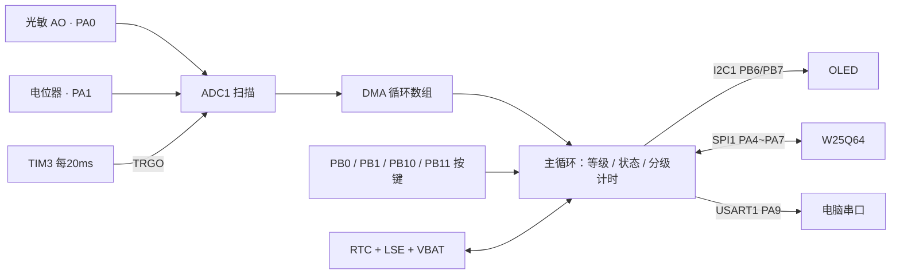
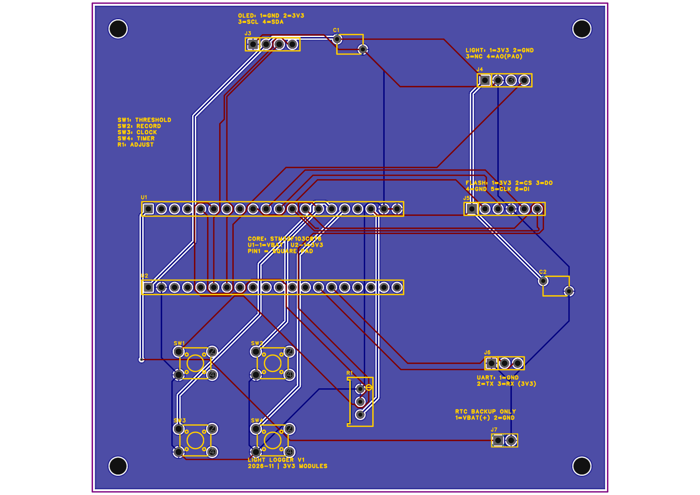

# 26无线杯比赛 A题 · 光照记录仪

基于 **STM32F103C8T6 + HAL** 的光照记录仪，使用 CubeMX 配置、Keil 编译；自制双层PCB底板通过排母连接现有核心板、OLED、光敏和Flash模块。

**状态：面包板软件功能已验证；PCB布线完成、DRC检查0项问题。尚未制造和焊接，1∶1纸样与实物孔位核对待完成。** 本目录为队内协作及项目展示版本。

## 已实现功能

- 开机短暂显示 `Light Logger`，随后显示光照电压、弱/中/强等级和分级累计秒数。
- 光敏PA0、电位器PA1双通道采样：TIM3每20ms通过TRGO触发ADC，DMA循环搬运结果。
- 电位器配合按键调整两条等级分界，现场可重新设定阈值。
- 长按约1秒开始/停止记录，保留最近三次完整记录及开始日期、时间，支持历史查看与日期筛选。
- 板载RTC校时、每日自动启停，支持跨午夜的定时区间。
- W25Q64保存阈值和完整历史记录；VBAT备用供电、LSE晶振维持断主电源期间RTC走时。
- USART1以115200、8N1输出调试数据。

光敏模块的实测关系为：**遮光电压增大、照亮电压减小**。当前使用STM32片内ADC，而不是参考电路的ADC0832。

## 工程入口

| 内容 | 位置 |
|---|---|
| Keil工程 | [firmware/wuxianbeiproject/MDK-ARM/wuxianbeiproject.uvprojx](firmware/wuxianbeiproject/MDK-ARM/wuxianbeiproject.uvprojx) |
| CubeMX配置 | [wuxianbeiproject.ioc](firmware/wuxianbeiproject/wuxianbeiproject.ioc) |
| 主程序 | [main.c](firmware/wuxianbeiproject/Core/Src/main.c) |
| 可编辑原理图、PCB与库 | [嘉立创EDA原生工程](hardware/WirelessLightLogger_20261112.epro2) |
| 硬件及布线说明 | [hardware/README.md](hardware/README.md) |
| 接线表、装配核对 | [docs/接线与硬件核对.md](docs/接线与硬件核对.md) |
| 操作及验收步骤 | [docs/操作与验收.md](docs/操作与验收.md) |
| 实际元件编号与封装 | [docs/EDA实际元件与封装.md](docs/EDA实际元件与封装.md) |
| 版本检查记录 | [docs/验证记录.md](docs/验证记录.md) |

## 系统关系

## 编译与运行

1. 下载仓库后，将完整 `firmware/wuxianbeiproject` 复制到英文路径，例如 `D:/STM32project/wuxianbeiproject`，再打开Keil工程，避免旧版工具对中文路径的兼容问题。
2. 已验证环境：Arm Compiler 6.24、`Keil.STM32F1xx_DFP.2.4.1`、`ARM.CMSIS.6.3.0`；CubeMX 6.18.1、STM32CubeF1 V1.8.7。HAL/CMSIS源码及原有许可证随工程保留。
3. 器件选择STM32F103C8，Flash 64KB、RAM 20KB，使用中容量启动文件 `startup_stm32f103xb.s`。当前系统时钟8MHz，不应直接改时钟而忽略定时器和外设配置。
4. 按接线表连接模块，用ST-Link编译、下载；检查下载器设置中的自动运行选项。串口模块RXD接PA9，GND共地，使用3.3V逻辑。
5. 首次使用或主电源与VBAT都断开后，通过按键进入校时，再按验收文档测试。

## PCB预览

[查看原理图预览](hardware/Schematic_preview.webp)。预览图不能用于1∶1孔位打印或生产。

## 已知限制与后续工作

- 底板100×95mm，两排核心板排母暂按15.24mm中心距；尚未打印纸样对实物。模块插向、封装孔距、螺丝头和插拔空间仍需确认。
- 定时参数和定时开关、未停止的当前记录不写入Flash；保存的是两条阈值和最近三条完整记录。
- RTC持续走时需要LSE及有效VBAT供电；Flash不能替代断电计时。VBAT只给备份域供电，不是整机电源。
- Flash快照区为 `0x7FD000`、`0x7FE000`，`0x7FF000`为历史测试区；扩展功能需避免覆盖。
- 当前没有加入语音、温湿度、电池管理等拓展功能；队友确定新增需求后再规划接口、电源和软件。
- 本目录不包含Gerber或钻孔生产文件；未下单，尚未做焊接后整机与长时间可靠性验收。

## 第三方内容

ST HAL、CMSIS和器件支持文件沿用各自原有许可证与版权声明，见 `firmware/wuxianbeiproject/Drivers` 内对应 `LICENSE.txt`。器件库资料及型号来自EDA所关联的第三方库。仓库公开用于展示与学习，不额外为整份工程声明统一开源许可证。
