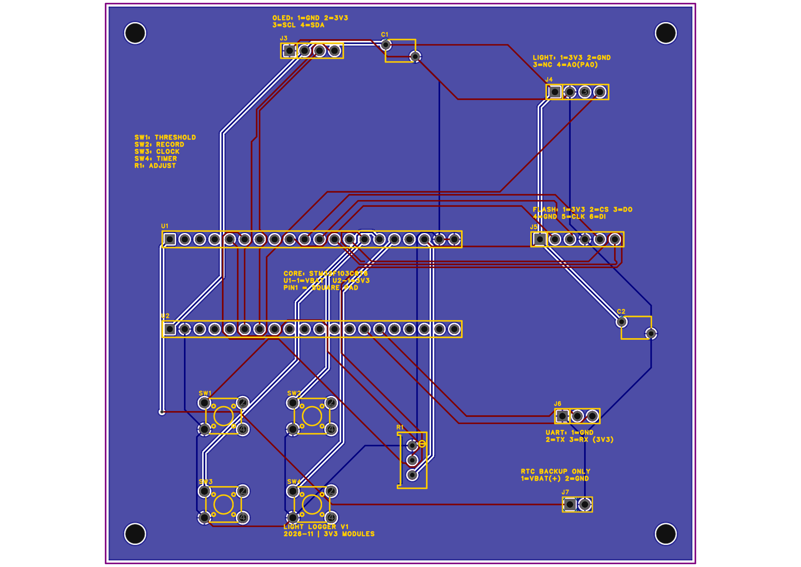
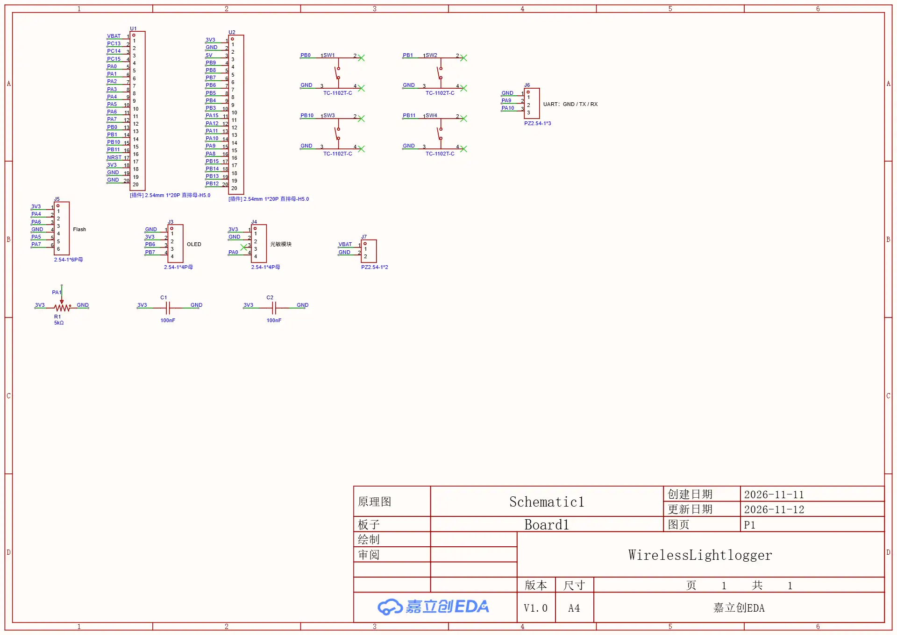

# 原理图、PCB与布线

`WirelessLightLogger_20261112.epro2` 是嘉立创EDA专业版4.1.99导出的V3原生工程，包含原理图、PCB、器件符号、封装及相关3D资料。下载原文件，通过嘉立创EDA专业版打开或导入后继续编辑。

## 文件

- `PCB_preview.webp`：原生工程中的PCB预览，展示当前走线。
- `Schematic_preview.webp`：原理图预览。
- `pcb-pad-net.csv`：直接从PCB原生数据提取的焊盘—网络对照表，可用表格软件查看。
- `routing-native.json`：原生走线和过孔记录，保留其字段；长度原单位为mil，乘0.0254得到mm。不是Gerber，也不是重新导入EDA的替代格式。

## 当前布线状态

底板为100×95mm双层板，14个底板元件、189段走线、1个过孔、1块GND铺铜。信号在顶层、底层分担布线，插孔焊盘连接两侧铜层；独立过孔用于中途换层。

唯一独立过孔属于VBAT网络：原生坐标X=9.556mm、Y=-49.277mm，外径0.6mm、钻孔0.3mm。模块接口、正负极、按键功能和核心板方向已有顶层丝印。2026-11-12完成丝印后，在EDA运行DRC（Design Rule Check，设计规则检查），显示0项问题、141项检查。

## 制造前仍需做的事

1. 先确定是否增加新功能；涉及新模块时重新检查电源预算、引脚及布局。
2. 从EDA按100%比例打印PCB纸样，并量板框确认打印比例。上述预览图不具备1∶1打印保证。
3. 核心板两排暂按15.24mm中心距；用实物核对20针孔位、OLED/Flash插向、电位器针距，以及竖立光敏模块的偏移和高度。
4. 检查模块与按键、核心板底面焊点、安装螺丝头及插拔空间的避让。
5. 若更改布局或布线，重新铺铜并运行DRC；装配核对通过后才导出生产文件、下单。

当前PCB尚未制造和焊接。DRC通过只表示所检查的电气/几何规则通过，不代表实物装配已经验证。
