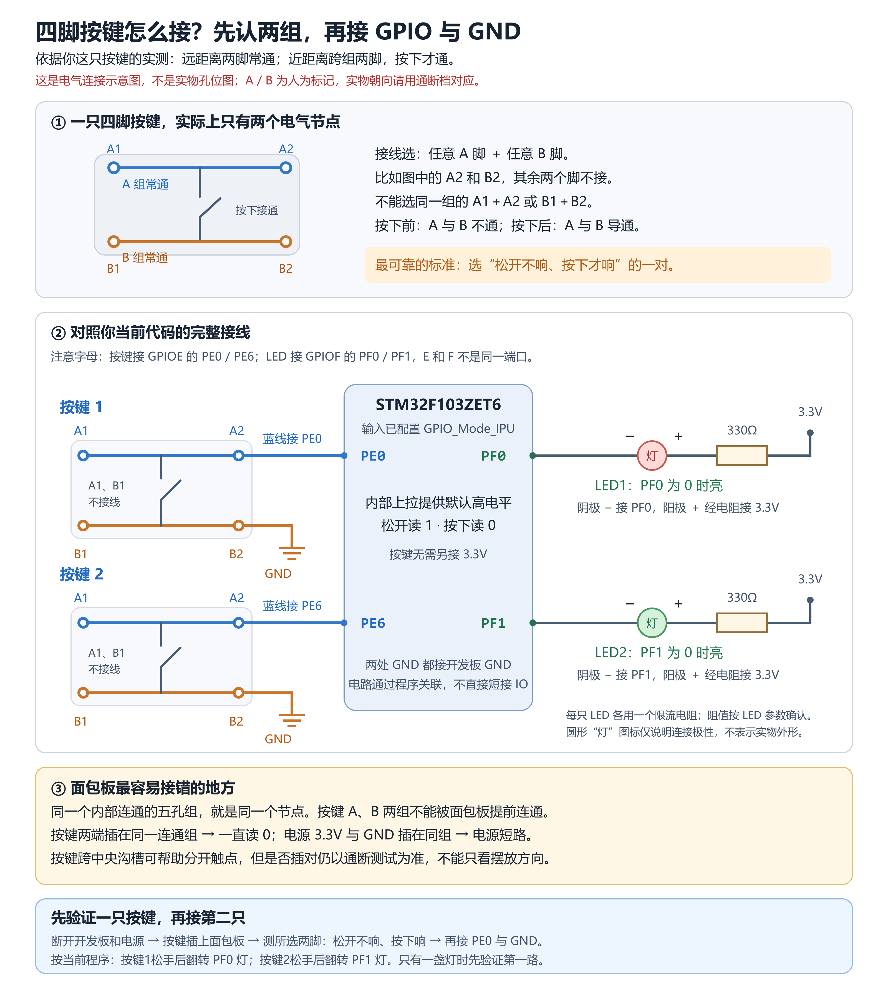

# STM32 按键控制 LED

RoboMini 机甲杯电控初筛中级任务③学习工程：使用 GPIO 上拉输入读取按键，结合软件消抖，控制两路 LED 亮灭。

## 演示

[按键控制 LED 演示视频](media/按键控制LED.mp4)

视频是本次按键实验的实际录像，不是之前初级点灯实验的视频。视频已收入本目录；原对话摘录中“等待视频”描述的是整理当时的状态。

## 开发环境

| 项目 | 配置 |
|---|---|
| 开发板 | 正点原子精英板，STM32F103ZET6 |
| Keil 目标芯片 | STM32F103ZE |
| 开发工具 | Keil MDK5，ARM Compiler 6.24 |
| 设备支持包 | Keil.STM32F1xx_DFP 2.4.1 |
| 固件库 | STM32F10x 标准外设库（SPL） |
| 启动文件 | `startup_stm32f10x_hd.s` |

这是标准库工程，不是 CubeMX/HAL 工程，不包含生成的 `.ioc` 文件。

## 引脚与接线

| 功能 | 引脚 | 说明 |
|---|---|---|
| 按键 1 | PE0 | 内部上拉，按键另一组触点接开发板 GND |
| 按键 2 | PE6 | 内部上拉，按键另一组触点接开发板 GND |
| LED 1 | PF0 | 低电平点亮，按键 1 切换状态 |
| LED 2 | PF1 | 低电平点亮，按键 2 切换状态 |

外接 LED 使用独立限流电阻，连接关系为：`3.3V → 限流电阻 → LED 阳极 → LED 阴极 → GPIO`。接线图中的 330Ω 是建议值，未据照片断言实际使用阻值。

按键松开时输入为 `1`，按下接地后为 `0`。现有代码在按下后延时 20ms、等待松手、再延时 20ms，随后切换灯状态。两个按键分别控制两路灯，返回的 `KeyNum` 为按键编号，不是累计按压次数。

## 目录

```text
Project/        Keil 完整源工程及必要配置
docs/           按键插法研究记录、对话摘录、接线说明与复习图
media/          本次按键控灯演示视频
checks/         文件清单、SHA256 校验与整理说明
.gitignore      编译产物、个人界面文件和临时文件忽略规则
README.md       工程说明
```

## 打开工程

1. 完整下载或克隆仓库，不要只下载 `main.c`。
2. 使用 Keil 打开 `Project/Project.uvprojx`，选择 `Target 1`。
3. 安装对应 STM32F1 设备包，确认使用 ARM Compiler 6，再执行重新编译。
4. 按上表接线，用适合开发板的下载器连接 SWD，检查供电与接地后下载。

整理时保存的原工程编译日志显示 **0 个错误、0 个警告**（2026-10-16 15:06:45）。本次仅复制、检查文件，没有重新编译、烧录或复现实物测试；不把历史日志当作新构建结果。

## 四脚按键插法研究

这次最重要的卡点不是程序语法，而是面包板提前连接了本来应该由按下动作接通的两组触点。

1. 通过万用表通断档，识别按键同组两脚常通、跨组按下才通。
2. 学习者确认照片中按键“左右联通，上下不连通”。
3. 根据照片方向，面包板主孔区同一竖列、沟槽同侧的五孔连通，原插法把上下两组旁路。
4. 建议断电后旋转按键 90°并调整位置，让不同触点组不在同一连通五孔组。
5. 学习者调整后反馈“成功了”。没有成功后孔位照片，因此没有虚构最终孔号。

完整过程见 [研究记录](docs/01_四脚按键插法研究记录.md)、[对话摘录](docs/02_相关对话摘录.txt) 和 [最终接线说明](docs/03_最终接线与程序说明.md)。




复习笔记里 PB0、PE2 等属于历史示例，复现本工程以本页引脚表为准。原代码保留了学习时的不准确注释，相关纠正在接线说明中列出，本次没有擅自修改源代码。

## 实现边界与安全

- 使用基础阻塞式消抖；长按会等待松手，不是多任务、非阻塞按键状态机。
- 延时后未再次确认低电平，且两个判断先后执行，不保证同时按键时分别响应。
- 改线、测通断前必须断电。按键插入面包板后，应重新确认跨组“松开不通，按下才通”。
- 电源正极和 GND 不能接到同一连通五孔组，LED 必须有限流电阻。

## 上传 GitHub

把此文件夹中的 `Project`、`docs`、`media`、`checks`、`README.md` 和 `.gitignore` 一起复制到你的本地仓库，再通过 GitHub Desktop 提交、推送或发布。不要只上传演示视频或单个源文件，也不用再次压缩。

已排除 `Objects/`、`Listings/`、个人 `.uvguix.*`、旧备份与临时文件；保留 `.uvprojx`、`.uvoptx`、源代码、头文件、启动文件、标准库及相关调试配置。

此文件夹尚未执行提交、推送或发布。标准库及其他第三方文件原有版权声明保持不变；本次未另行添加开源许可证。
